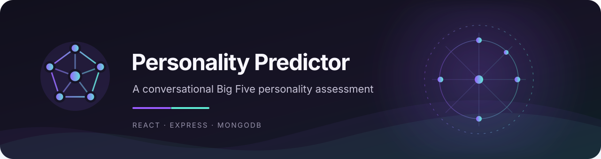
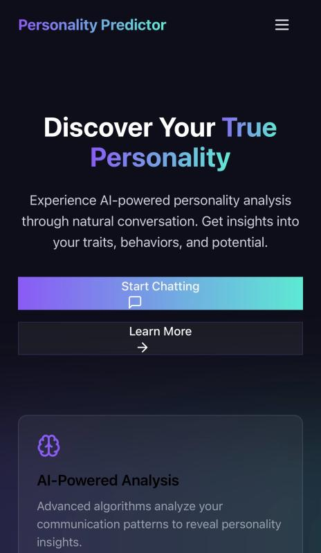
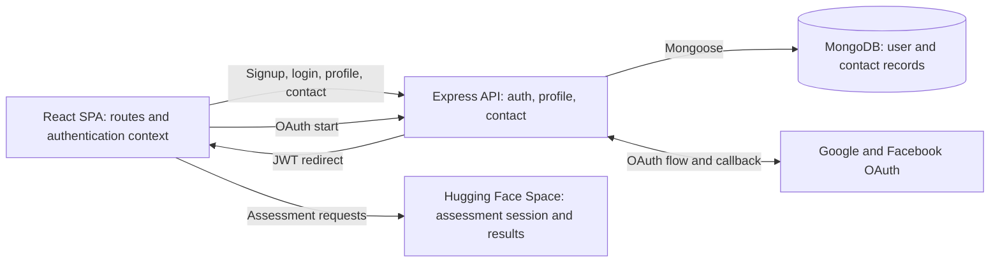

<div align="center">

# Personality Predictor

**A conversational Big Five questionnaire with a React frontend and an Express/MongoDB account API.**



[](https://github.com/Attayab-31/Personality-Predictor-ChatBot/stargazers)
[](https://github.com/Attayab-31/Personality-Predictor-ChatBot)
[](https://github.com/Attayab-31/Personality-Predictor-ChatBot/commits/main)
[](LICENSE)
[](https://react.dev/)
[](https://expressjs.com/)
[](https://www.mongodb.com/)

**[⭐ Star this repository](https://github.com/Attayab-31/Personality-Predictor-ChatBot/stargazers)** · [Report a bug](https://github.com/Attayab-31/Personality-Predictor-ChatBot/issues/new) · [Read the architecture](#04--system-architecture)

[](https://twitter.com/intent/tweet?text=Check%20out%20Personality%20Predictor%20on%20GitHub&url=https%3A%2F%2Fgithub.com%2FAttayab-31%2FPersonality-Predictor-ChatBot)
[](https://www.linkedin.com/sharing/share-offsite/?url=https%3A%2F%2Fgithub.com%2FAttayab-31%2FPersonality-Predictor-ChatBot)
[](https://www.facebook.com/sharer/sharer.php?u=https%3A%2F%2Fgithub.com%2FAttayab-31%2FPersonality-Predictor-ChatBot)
[](https://www.reddit.com/submit?url=https%3A%2F%2Fgithub.com%2FAttayab-31%2FPersonality-Predictor-ChatBot&title=Personality%20Predictor)
[](https://wa.me/?text=Personality%20Predictor%20on%20GitHub%3A%20https%3A%2F%2Fgithub.com%2FAttayab-31%2FPersonality-Predictor-ChatBot)

</div>

<p align="center">
  
</p>

> Personality Predictor is a web application for taking a short, conversational personality assessment. The questionnaire and scoring are provided by an external Hugging Face Space; this repository contains the web client and a separate account/contact API.

## On this page

[Overview](#01--overview) · [Features](#02--features) · [Screenshots](#03--screenshots) · [Architecture](#04--system-architecture) · [Stack](#05--technology-stack) · [Structure](#06--project-structure) · [Quickstart](#07--quickstart) · [API](#08--api-documentation) · [Testing](#09--testing) · [Security](#10--security--limitations) · [Roadmap and license](#11--roadmap-and-license)

## 01 — Overview

Complete a 15-question Big Five assessment in a chat-style interface. Create an account to access the assessment. The Express API handles account signup, login, OAuth callbacks, profile lookup, and contact submissions.

This project is an application prototype, not a clinical instrument. The app does not include a personality model or independently validate assessment results.

## 02 — Features

- **Assessment** — conversational 15-question Big Five flow backed by an external service.
- **Accounts** — email/password signup and login with bcrypt password hashing and JWTs.
- **Social sign-in** — Google and Facebook OAuth routes, when provider credentials and callbacks are configured.
- **Profile** — bearer-token protected endpoint for the signed-in user's public profile.
- **Contact** — validated contact submissions stored in MongoDB.
- **Responsive UI** — routed pages for the home page, features, assessment, team compatibility, contact, account, blog, careers, and policies.
- **API safeguards** — Helmet, CORS configuration, request validation, Morgan logging, and IP-based rate limiting.

The AI analysis and team compatibility pages currently lead to the same individual questionnaire. They do not provide separate analysis or team workflows. Blog search and category controls are presentational.

## 03 — Screenshots

### Home page · mobile

<p align="center">
  
</p>

The screenshot is included in [`docs/screenshots/`](docs/screenshots/). Add further captures there for the assessment conversation and results when available. Use non-sensitive sample data.

## 04 — System Architecture



The browser calls the assessment service directly. The Express API does not proxy assessment traffic. It persists accounts and contact submissions in MongoDB. The frontend stores JWTs in `localStorage` and sends them as bearer tokens for profile lookup.

## 05 — Technology Stack

| Layer | Technologies | Responsibility |
| --- | --- | --- |
| Frontend | React 19, React Router 7 | Routed single-page application |
| Forms and state | React Hook Form, TanStack Query, React Context | Form handling, shared auth state, query client |
| Styling | Tailwind CSS, PostCSS, custom CSS | Responsive interface and visual system |
| Backend | Node.js, Express 4, Passport | Authentication, OAuth, profile and contact routes |
| Database | MongoDB, Mongoose | User and contact records |
| Security | bcryptjs, jsonwebtoken, Helmet, express-validator, express-rate-limit | Password hashes, JWTs, headers, validation and throttling |
| Assessment | Hugging Face Space | External session, question and result service |

## 06 — Project Structure

```text
.
├── backend/
│   ├── src/
│   │   ├── config/          # MongoDB connection and Passport strategies
│   │   ├── controllers/     # Authentication and contact handlers
│   │   ├── middleware/      # JWT protection
│   │   ├── models/          # Mongoose schemas
│   │   ├── routes/          # Auth and contact routes
│   │   └── index.js         # Express app and server
│   ├── .env.example
│   └── package.json
├── docs/screenshots/        # README product screenshots
├── public/                  # HTML shell, manifest and static assets
├── src/
│   ├── api/                 # Assessment endpoint definitions
│   ├── components/          # Shared layout and UI components
│   ├── context/             # Frontend authentication state
│   ├── hooks/               # Toast and responsive-layout hooks
│   ├── pages/               # Routed views
│   ├── App.jsx              # Routes and providers
│   └── index.js             # React entry point
├── .env.example             # Frontend configuration template
├── package.json             # Frontend scripts and dependencies
└── LICENSE                  # GNU AGPL v3
```

## 07 — Quickstart

### Requirements

- Node.js and npm.
- MongoDB for account and contact data.
- Access to the configured Hugging Face Space for the questionnaire.
- Google or Facebook OAuth credentials only if those sign-in options are needed.

### Install

```bash
git clone https://github.com/Attayab-31/Personality-Predictor-ChatBot.git
cd Personality-Predictor-ChatBot
npm ci
cp .env.example .env
cd backend
npm ci
cp .env.example .env
```

On Windows PowerShell, use `Copy-Item .env.example .env` in the repository root and inside `backend/`.

Configure `backend/.env` with your MongoDB URI and a private JWT secret. The example file also sets `FRONTEND_URL=http://localhost:3000` for local CORS. Start the API from `backend/`:

```bash
npm run dev
```

In a second terminal, from the repository root, start the frontend:

```bash
npm start
```

Open [http://localhost:3000](http://localhost:3000). The backend listens on port `5000` by default.

### Frontend configuration

The root `.env.example` documents the frontend settings:

```dotenv
# Auth requests expect this base URL to include /api.
REACT_APP_API_URL=http://localhost:5000/api

# Used by the shared assessment endpoint module.
REACT_APP_HF_API_URL=https://hunzalarasheed1-personality-assessment-api.hf.space
```

The active chat page currently hard-codes the Hugging Face Space URL, so changing `REACT_APP_HF_API_URL` does not change that page yet. The `REACT_APP_API_URL` value also feeds a declared but unused `/chat` endpoint; this Express backend does not implement `/chat`.

OAuth callbacks in `backend/src/config/passport.js` point to a deployed backend host. Update those callback URLs and the OAuth provider console settings before using OAuth locally or on another deployment.

## 08 — API Documentation

The Express API defaults to `http://localhost:5000`. JSON bodies are required where shown. Validation errors return `400`; protected routes return `401` when a bearer token is missing or invalid. A global rate limiter allows up to 100 requests per IP per 15-minute window.

### Authentication and profile

| Method | Endpoint | Access | Result |
| --- | --- | --- | --- |
| `POST` | `/api/auth/signup` | Public | Create user; return `201` and a JWT |
| `POST` | `/api/auth/login` | Public | Verify credentials; return a JWT |
| `GET` | `/api/auth/user/profile` | Bearer JWT | Return public profile fields |
| `GET` | `/api/auth/google` | Public | Start Google OAuth |
| `GET` | `/api/auth/google/callback` | OAuth callback | Redirect to frontend with token and user ID |
| `GET` | `/api/auth/facebook` | Public | Start Facebook OAuth |
| `GET` | `/api/auth/facebook/callback` | OAuth callback | Redirect to frontend with token and user ID |

Signup body:

```json
{
  "name": "Alex Example",
  "email": "alex@example.com",
  "password": "a-long-private-password"
}
```

Successful signup and login return `_id`, `name`, `email`, and `token`. Duplicate signup returns `400`; invalid login returns `401`.

Profile request and response:

```http
GET /api/auth/user/profile
Authorization: Bearer <jwt>
```

```json
{
  "_id": "<user-id>",
  "name": "Alex Example",
  "email": "alex@example.com",
  "profilePic": ""
}
```

### Contact form

`POST /api/contact` requires all fields below. A successful submission returns `201` with `{ "success": true, "data": <contact> }`.

```json
{
  "firstName": "Alex",
  "lastName": "Example",
  "email": "alex@example.com",
  "subject": "Question",
  "message": "How does the assessment work?"
}
```

### External assessment API

The assessment page calls the Hugging Face Space directly. The active flow uses these endpoints:

<details>
<summary>Expand the external assessment endpoint reference</summary>

| Method | Path | Purpose |
| --- | --- | --- |
| `GET` | `/health` | Check the assessment service |
| `POST` | `/start-assessment` | Create an assessment session |
| `POST` | `/submit-profile/:sessionId` | Send `profession`, `field`, and `interests` |
| `GET` | `/get-question/:sessionId` | Fetch the current question |
| `POST` | `/submit-answer` | Submit `{ "session_id": "…", "answer": "…" }` |
| `GET` | `/get-results/:sessionId` | Retrieve the assessment result |
| `GET` | `/session-status/:sessionId` | Check session progress |

</details>

The external service defines the response schemas; they are not versioned in this repository. `src/api/endpoints.js` also declares `DELETE /delete-session/:sessionId` and `POST /chat`; those are not used in the active questionnaire flow, and `/chat` is not implemented by this Express API.

## 09 — Testing and Build

The frontend has Create React App's test runner and Testing Library setup, but no application test files. The backend has no test suite or test script. No CI workflow or test metrics are configured, so this README does not display a passing-tests badge.

Build the frontend for production:

```bash
npm run build
```

The backend `build` script currently invokes itself recursively. Use `npm start` to launch the backend, or fix the script before using a backend build command.

## 10 — Security and Limitations

- **Secrets:** Keep `.env` files private. Both `.env.example` files contain placeholders/configuration only. Rotate any real credential that was committed previously; removing it from the latest tree does not remove it from Git history.
- **Passwords and tokens:** Passwords are hashed with bcryptjs. JWTs expire after 30 days and are stored in browser `localStorage`, which JavaScript on the page can access.
- **OAuth:** Callback URLs are hard-coded in Passport configuration and need to match the provider console.
- **Assessment data:** Responses are sent directly from the browser to a separately operated service. Check that service's privacy, retention, availability, and CORS practices before using personal data.
- **Result limits:** Treat results as informational, not clinical or diagnostic. Scoring and model behavior depend on the external service.
- **Unimplemented flows:** The team compatibility and AI analysis pages do not have dedicated analysis workflows. The blog search/filter controls are presentational.
- **Contact form:** The routed contact page currently posts to a hard-coded deployed backend URL.
- **Marketing copy:** Review privacy and security claims in the site pages before publishing; the code does not implement every claim shown there.

## 11 — Roadmap and License

### Roadmap

- Add frontend and backend tests, plus CI reporting.
- Make assessment, API, and OAuth URLs configurable for every environment.
- Add a working backend health endpoint and repair the backend build script.
- Implement or remove the unused general chat endpoint.
- Build a separate team assessment workflow if that feature is in scope.
- Add more reviewed screenshots and replace placeholder contact/social details.

### License

Licensed under the **GNU Affero General Public License v3.0 only (AGPL-3.0-only)**. See [`LICENSE`](LICENSE) for the complete terms. The AGPL includes a source-offer requirement when users interact over a network with a modified version of the covered software. There is no separate paid tier or revenue-based pricing boundary defined by this repository; AGPL obligations still apply. Check third-party dependency licenses separately.

## Contact and community

- **WhatsApp:** [+92 317 4026038](https://wa.me/923174026038)
- **Email:** [attayabpc2@gmail.com](mailto:attayabpc2@gmail.com)
- **LinkedIn:** [Muhammad Attayab Ashraf](https://pk.linkedin.com/in/muhammad-attayab-ashraf-519562262)
- **Freelancer:** [MuhammadAttayab](https://www.freelancer.com/u/MuhammadAttayab)
- **Issues and feature requests:** [GitHub Issues](https://github.com/Attayab-31/Personality-Predictor-ChatBot/issues)
- **Source and contributions:** [Repository](https://github.com/Attayab-31/Personality-Predictor-ChatBot)
- **Support the project:** [⭐ Star Personality Predictor](https://github.com/Attayab-31/Personality-Predictor-ChatBot/stargazers)
